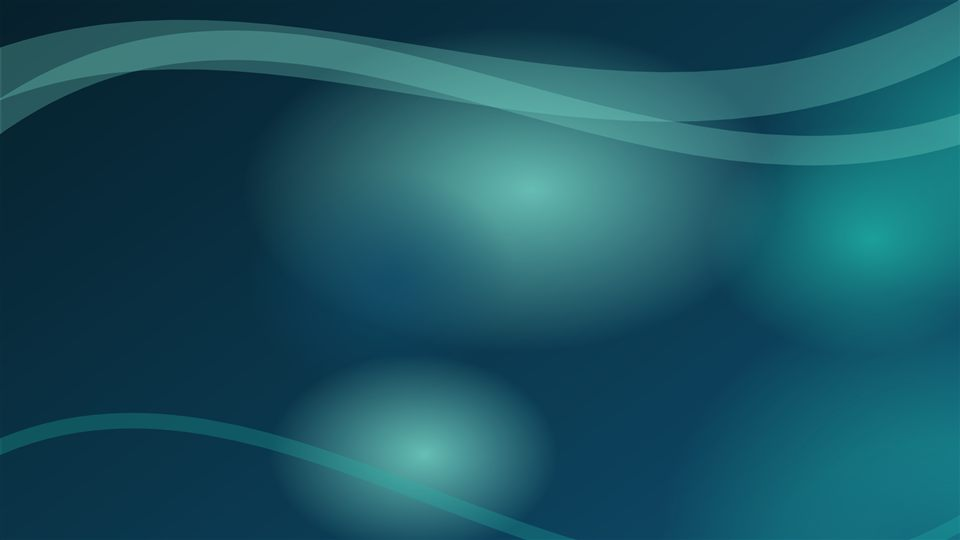
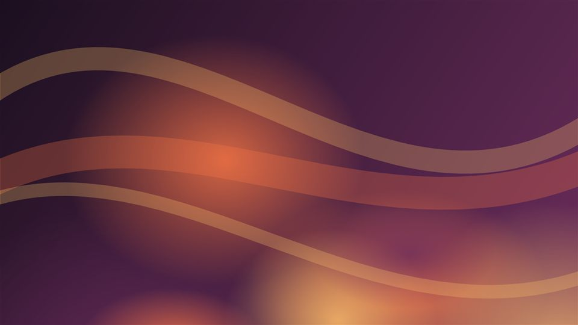
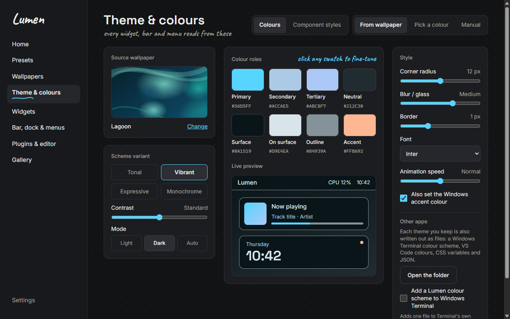
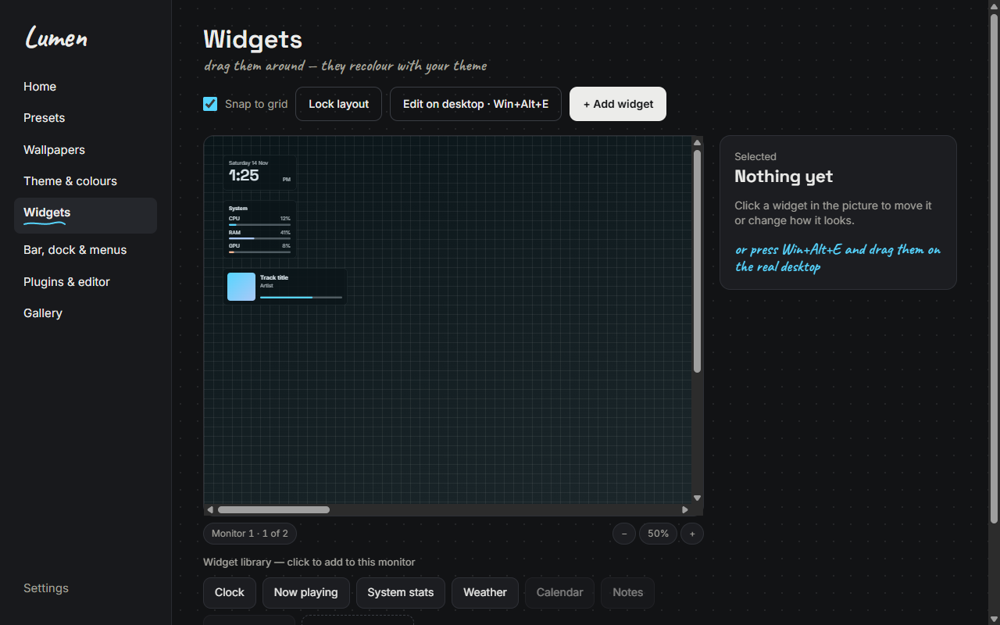
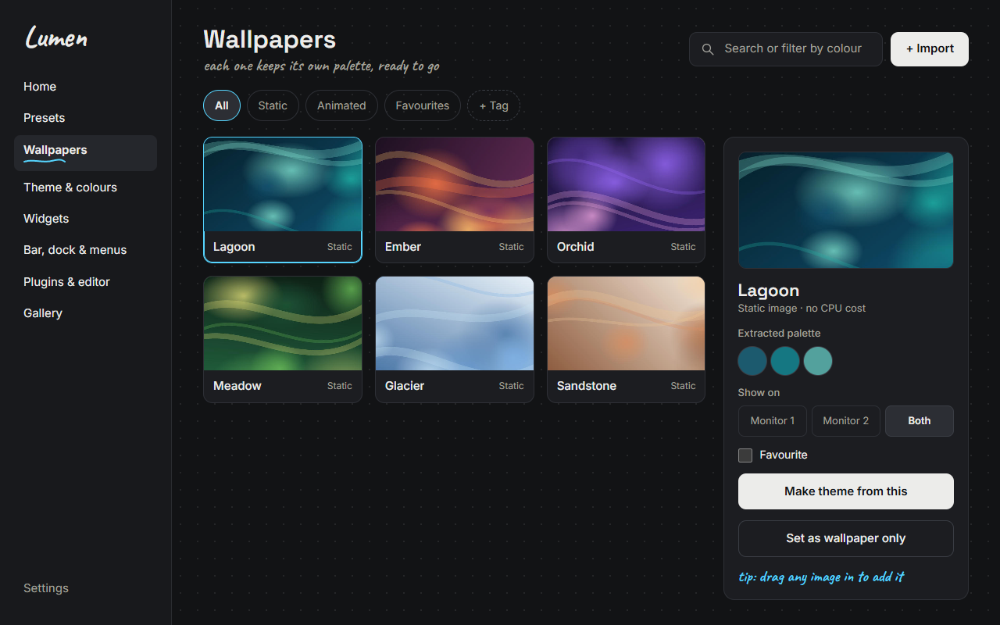
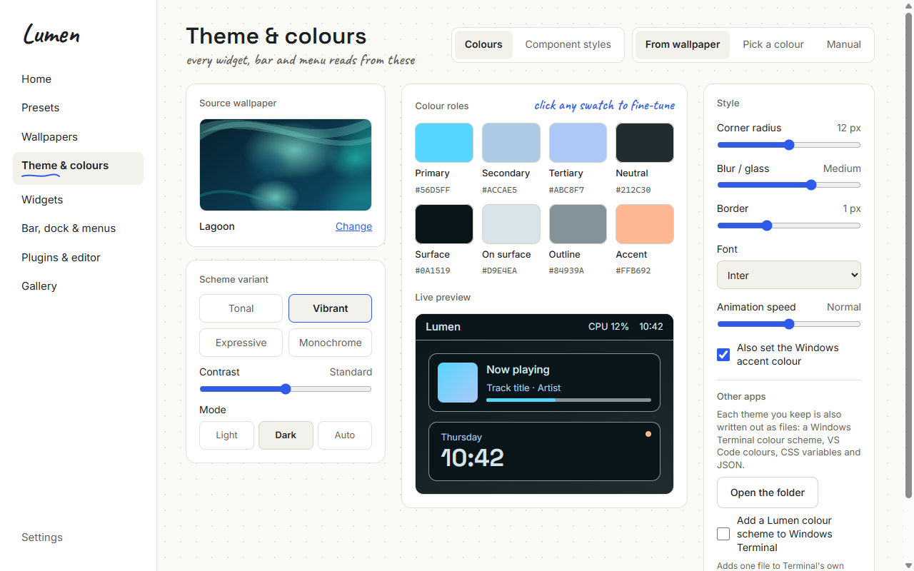

<p align="center">
  
</p>

<h1 align="center">Lumen</h1>

<p align="center">
  <b>One theme for your whole Windows 11 desktop.</b><br>
  Change the wallpaper. Everything follows.
</p>

<p align="center">
  <a href="https://github.com/Bryson-he/lumen/releases/latest"></a>
  &nbsp;
  <a href="https://bryson-he.github.io/lumen/"></a>
  &nbsp;
  <a href="LICENSE"></a>
</p>

<p align="center">
  <a href="#on-a-real-desktop">On a real desktop</a> ·
  <a href="#what-it-does">What it does</a> ·
  <a href="#inside-the-app">Inside the app</a> ·
  <a href="#the-gallery">Gallery</a> ·
  <a href="#download">Download</a>
</p>

<br>

## On a real desktop


### Widgets that look like part of the wallpaper

This is a desktop in daily use. Every piece on it is a Lumen widget with its background switched off, coloured by the theme Lumen made from the photo behind it.

- **Date and clock.** Two fonts in one widget: a handwritten date over a large clock.
- **Now playing.** Cover, title and artist, with progress as a row of blocks instead of a bar.
- **System.** Processor, memory and graphics as thin bars.
- **Phone charge.** A phone's battery level, read live from Home Assistant.

Nothing here needed code. Each widget was arranged with the mouse in Lumen's designer.

<br clear="both">

## What it does

<p align="center">
  
</p>

<details>
<summary><b>Everything, as a list</b></summary>
<br>

- **Themes from a wallpaper.** A palette of eight colour roles, with tonal, vibrant, expressive and monochrome variants, light and dark. Try a theme for 15 seconds before keeping it.
- **Widgets.** Clock, system stats, now playing and weather, placed anywhere on any monitor. Every part of a widget (each line of text, bar, ring, graph, icon) can be moved, restyled or hidden, with the mouse or as a YAML file.
- **Text that fits.** A line of text can fill its box, so resizing the box resizes the text. Any widget's contents can be scaled from 40% to 500%.
- **Meters your way.** Any level can be a bar, a row of blocks, a ring, a dial or a graph, and switched between them in one click.
- **Component styles.** Decide how cards look (background, border, corners, spacing, fonts) once and use it for widgets, the bar, the flyout and the launcher. Or switch the background off altogether.
- **Bar, volume flyout and launcher.** All drawn in the same theme.
- **Media buttons.** Play, pause and skip from a widget.
- **Home Assistant built in.** Connect once, then tick lights, plugs, scenes and sensors from a list to put them on your desktop, one each or several in a panel. See [docs/HOME-ASSISTANT.md](docs/HOME-ASSISTANT.md).
- **Scripted widgets.** A widget can have a small [Luau](https://luau.org) script that reads files, calls any web API or runs a program. Each script says what it needs and never runs until you have allowed it. See [docs/SCRIPTS.md](docs/SCRIPTS.md).
- **Weather.** From Open-Meteo, with colour or plain one-colour pictures.
- **Colours for other apps.** Every theme you keep is also written out as a Windows Terminal colour scheme, VS Code colours, CSS variables and JSON.
- **Presets.** Save, switch, export and import whole looks.

</details>

<br>

## Four wallpapers, four themes

<table>
  <tr>
    <td></td>
    <td></td>
    <td></td>
    <td></td>
  </tr>
  <tr>
    <td align="center">  <br><sub>Lagoon</sub></td>
    <td align="center">  <br><sub>Ember</sub></td>
    <td align="center">  <br><sub>Orchid</sub></td>
    <td align="center">  <br><sub>Meadow</sub></td>
  </tr>
</table>

<p align="center"><sub>The palettes Lumen made from each. These four pictures were drawn for this page.</sub></p>

<br>

## Inside the app

<table>
  <tr>
    <td width="50%"></td>
    <td width="50%"></td>
  </tr>
  <tr>
    <td align="center"><b>Theme &amp; colours</b><br><sub>Eight roles from the wallpaper. Click a swatch to fine-tune it.</sub></td>
    <td align="center"><b>Widgets</b><br><sub>Drag them on a picture of your monitor, or straight on the desktop.</sub></td>
  </tr>
  <tr>
    <td></td>
    <td></td>
  </tr>
  <tr>
    <td align="center"><b>Wallpapers</b><br><sub>Each one keeps its own palette, ready to go.</sub></td>
    <td align="center"><b>Gallery</b><br><sub>Widgets, styles and looks to add in one click.</sub></td>
  </tr>
</table>

<details>
<summary><b>And in light mode</b></summary>
<br>

</details>

<br>

## The gallery

Lumen comes with a gallery of widgets and styles, read from your own PC: clocks, a date tile, system dials and blocks, media controls, weather, a greeting and more. One button on the Gallery screen browses the **online gallery**, which is the [`gallery/`](gallery/) folder of this repository.

To share something you made, open the widget's Parts tab in Lumen and choose "Offer it to the online gallery…", or [open a submission](https://github.com/Bryson-he/lumen/issues/new?template=gallery-submission.yml) yourself. Each submission is looked at before it is listed. [gallery/README.md](gallery/README.md) has the details.

<br>

## Download

<p align="center">
  <a href="https://github.com/Bryson-he/lumen/releases/latest"></a>
</p>

- **Installing.** The installer is for your user only and needs no admin rights. It is not code-signed, so Windows SmartScreen will warn the first time: choose "More info", then "Run anyway".
- **Updates.** Lumen looks here for a newer version at most once a day when you open it, and tells you if there is one. Nothing is downloaded or installed until you click. You can switch the check off under Settings.
- **Privacy.** Lumen only goes online when you ask for something that needs it: weather, the online gallery, Home Assistant on your own network, an update check.

<br>

## Building from source

You need Rust (the toolchain in `rust-toolchain.toml`), Node.js and pnpm, on Windows 11.

```
pnpm install
cargo test --workspace
cd apps/settings
pnpm tauri dev
```

`pnpm tauri build` in `apps/settings` makes the installer. How the project is put together is in [docs/PLAN.md](docs/PLAN.md); why things were done the way they were is in [docs/DECISIONS.md](docs/DECISIONS.md); how a release is made is in [docs/RELEASING.md](docs/RELEASING.md).

## Licence

Lumen is released under the [MIT licence](LICENSE). The fonts shipped with it (Inter, Space Grotesk and Caveat) are under the SIL Open Font License.
