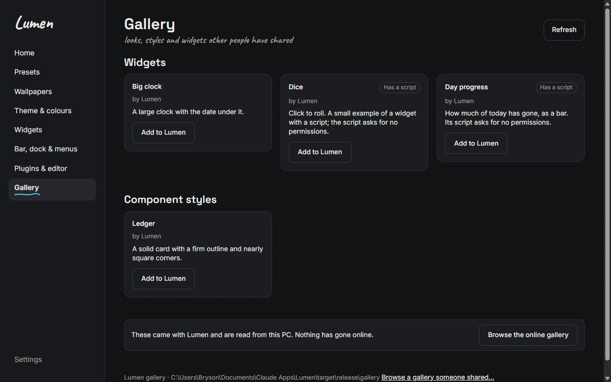

<p align="center">
  
</p>

<h1 align="center">Lumen</h1>

<p align="center"><b>One theme for your whole Windows 11 desktop.</b><br>Change the wallpaper. Everything follows.</p>

<p align="center">
  <a href="https://github.com/Bryson-he/lumen/releases/latest"></a>
  &nbsp;
  <a href="https://bryson-he.github.io/lumen/"></a>
  &nbsp;
  <a href="LICENSE"></a>
</p>

Pick a wallpaper and Lumen makes a colour palette from it, then uses that palette everywhere: desktop widgets, a status bar, the volume flyout, a launcher, the Windows accent colour, and the Lumen app itself. A whole look saves as a preset you can switch to in one click.

<table>
  <tr>
    <td></td>
    <td></td>
    <td></td>
    <td></td>
  </tr>
  <tr>
    <td align="center">  <br><sub>Lagoon</sub></td>
    <td align="center">  <br><sub>Ember</sub></td>
    <td align="center">  <br><sub>Orchid</sub></td>
    <td align="center">  <br><sub>Meadow</sub></td>
  </tr>
</table>

<sub>Four wallpapers and the palettes Lumen made from them. The artwork was drawn for these pages.</sub>

## Download

**[Download the latest installer](https://github.com/Bryson-he/lumen/releases/latest)** (`Lumen_x.y.z_x64-setup.exe`, about 5 MB, Windows 11).

The installer is not code-signed, so Windows SmartScreen will warn the first time: choose "More info", then "Run anyway". It installs for your user only and needs no admin rights.

Lumen looks for a newer version here at most once a day when you open it, and tells you if there is one. Nothing is downloaded or installed until you click. You can switch the check off under Settings.

## A look around

| Theme from a wallpaper | Widgets you can take apart |
|---|---|
|  |  |
| **Your wallpaper library** | **The gallery** |
|  |  |

Light or dark, the app follows Windows:


## What it does

- **Themes from a wallpaper.** A palette of eight colour roles, with tonal, vibrant, expressive and monochrome variants, light and dark. Try a theme for 15 seconds before keeping it.
- **Widgets.** Clock, system stats, now playing and weather, placed anywhere on any monitor. Every part of a widget (each line of text, bar, ring, graph, icon) can be moved, restyled or hidden, with the mouse or as a YAML file.
- **Component styles.** Decide how cards look (background, border, corners, spacing, fonts) once and use it for widgets, the bar, the flyout and the launcher.
- **Bar, volume flyout and launcher.** All drawn in the same theme.
- **Scripted widgets.** A widget can have a small [Luau](https://luau.org) script. Scripts can do a lot, so each one says what it needs (files, internet, running programs) and never runs until you have allowed it. See [docs/SCRIPTS.md](docs/SCRIPTS.md).
- **Colours for other apps.** Every theme you keep is also written out as a Windows Terminal colour scheme, VS Code colours, CSS variables and JSON.
- **Presets.** Save, switch, export and import whole looks.

## Light on your PC

- Idle target: under 0.5% CPU and 80 MB of memory for the background part plus widgets.
- Nothing is drawn while a fullscreen game is running.
- Lumen never injects into or hooks other programs, so it is safe alongside games with anti-cheat. It uses only public Windows features and its own windows.
- It never keeps your screens on or stops your PC sleeping.
- It only goes online when you ask for something that needs it: weather, the online gallery, an update check.

## The gallery

Lumen comes with a small gallery of widgets and styles, read from your own PC. The Gallery screen can also browse the **online gallery**, which is the [`gallery/`](gallery/) folder of this repository.

To share something you made: in Lumen, open the widget's Parts tab and choose "Offer it to the online gallery…", or [open a submission](https://github.com/Bryson-he/lumen/issues/new?template=gallery-submission.yml) yourself. Each submission is looked at before it is listed. [gallery/README.md](gallery/README.md) has the details.

## Building from source

You need Rust (the toolchain in `rust-toolchain.toml`), Node.js and pnpm, on Windows 11.

```
pnpm install
cargo test --workspace
cd apps/settings
pnpm tauri dev
```

`pnpm tauri build` in `apps/settings` makes the installer. How the project is put together is in [docs/PLAN.md](docs/PLAN.md); why things were done the way they were is in [docs/DECISIONS.md](docs/DECISIONS.md); how a release is made is in [docs/RELEASING.md](docs/RELEASING.md).

## Licence

Lumen is released under the [MIT licence](LICENSE). The fonts shipped with it (Inter, Space Grotesk and Caveat) are under the SIL Open Font License.
